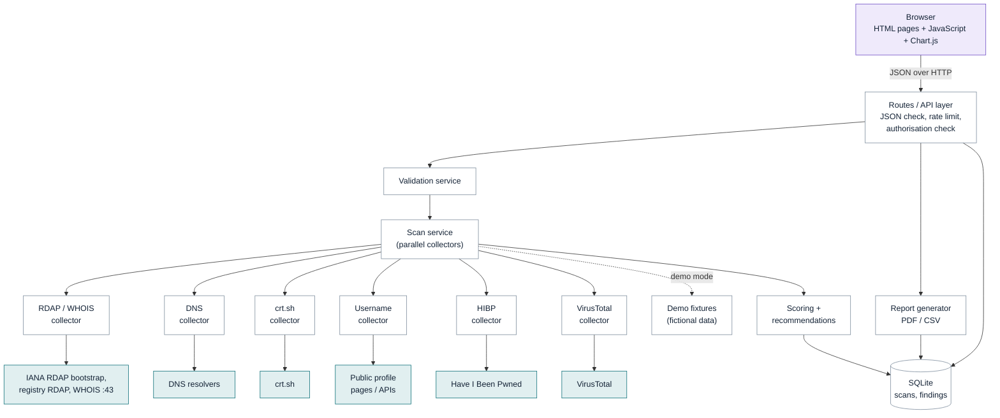
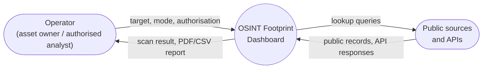
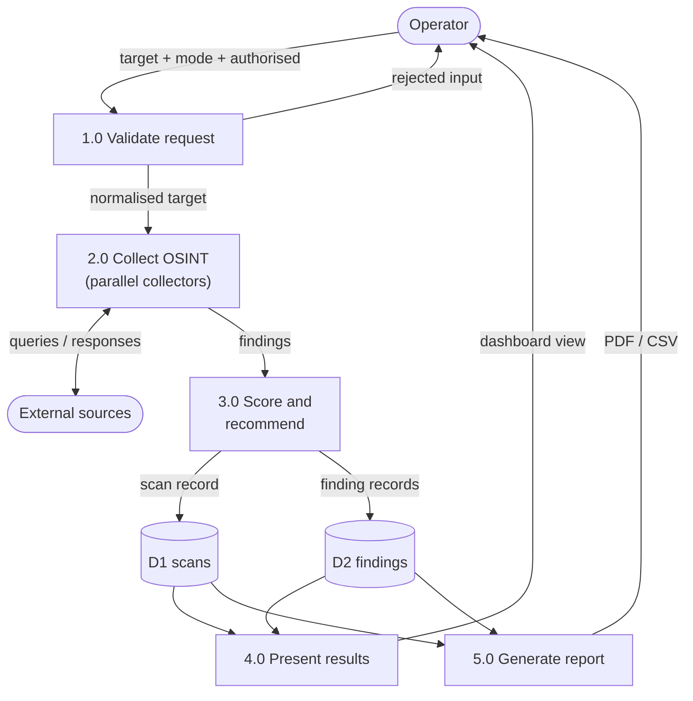
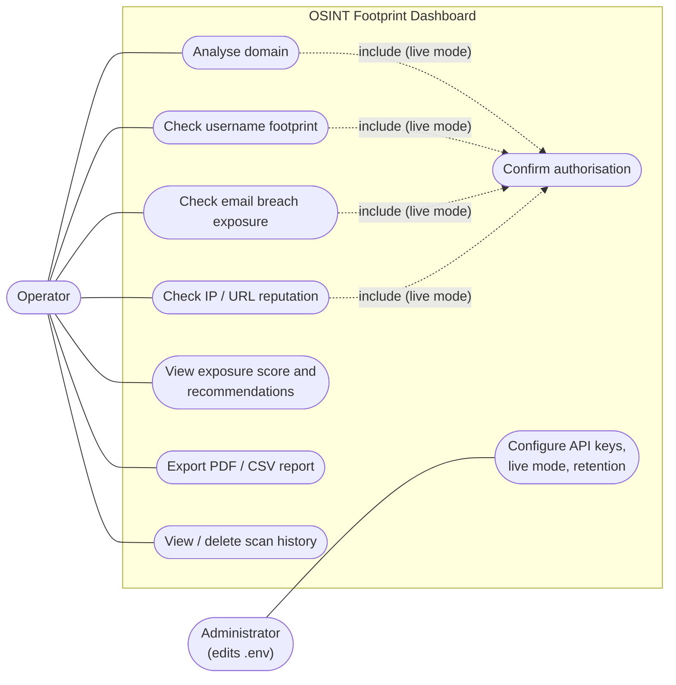
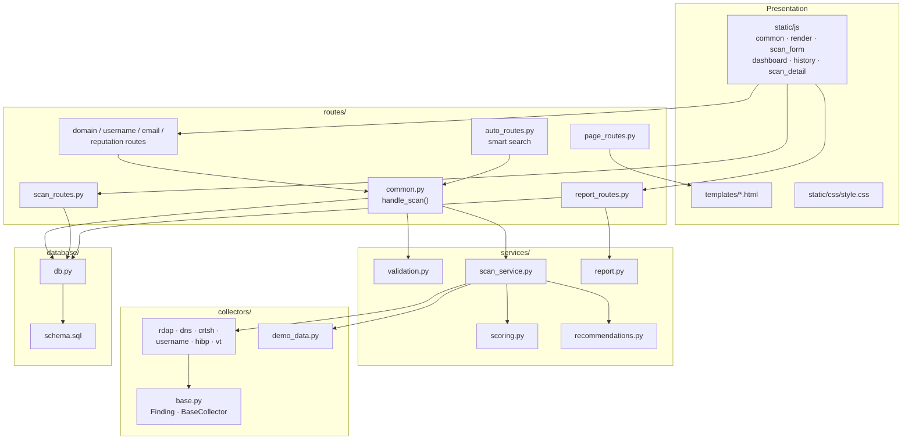
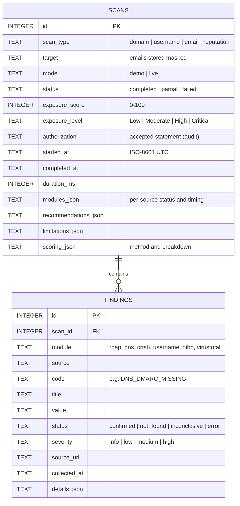
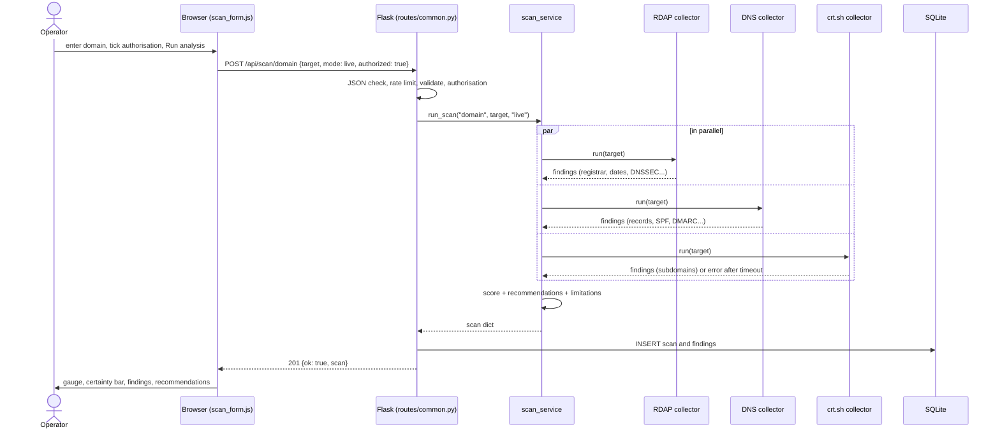

# System Architecture and Design

All diagrams are written in Mermaid (rendered PNGs are in `docs/diagrams/`). They render on GitHub, or paste them into
https://mermaid.live to export PNG/SVG images for the project report.

## 1. System architecture

Purple = client, white = Flask application, teal = external public sources.

**In simple terms:** the browser never talks to OSINT sources directly. It sends one JSON
request to Flask. Flask checks the input and the authorisation, then the scan service
starts the relevant collectors at the same time. Each collector talks to exactly one
external source and returns findings in a shared format. Those findings are scored, turned
into recommendations, saved in SQLite and sent back to the browser. In demo mode the
collectors are replaced by fictional fixtures, so nothing external is contacted.

## 2. Data-flow diagram

### Level 0 (context)

### Level 1

## 3. Use-case diagram

Mermaid has no native UML use-case diagram, so it is drawn as a flowchart. The prototype
has one human role, the **operator**. An administrator role is represented by
configuration (the `.env` file) rather than a login, which keeps the prototype simple.

## 4. Component diagram

| Component | Responsibility |
|---|---|
| `collectors/base.py` | The contract: `Finding` (module, source, code, title, value, status, severity, source_url, timestamp, details) and `BaseCollector.run()` (timing, timeout and error handling) |
| Collectors | One external source each; translate raw responses into findings |
| `scan_service.py` | Picks collectors for the scan type, runs them in a thread pool, aggregates results |
| `scoring.py` / `recommendations.py` | Turn findings into a 0-100 score and prioritised actions |
| `validation.py` | Allow-list validation and email masking |
| `routes/common.py` | Enforces JSON, demo/live rules and authorisation for all scan endpoints |
| `routes/auto_routes.py` | Smart search on the server: detects the target type and hands over to the matching module's scan |
| `db.py` | Parameterised SQLite access, retention purge (start-up and every save) |
| `report.py` | PDF and CSV generation with injection protection |

## 5. Database design

- **One-to-many:** a scan has many findings; `ON DELETE CASCADE` removes findings with
  their scan.
- `CHECK` constraints restrict status, severity, scan type and mode to valid values.
- JSON columns hold structured but rarely-queried data (tables for the UI, scoring
  breakdown), which keeps the schema to two tables.
- Indexes on `findings.scan_id` and `scans.started_at` support the history page and the
  retention purge.

## 6. Sequence of a live domain scan

## 7. How the parts interact

1. **Frontend to backend:** the pages are server-rendered shells; JavaScript calls the JSON
   API with `fetch`. All third-party values are inserted with `textContent`, and the CSP
   forbids inline scripts.
2. **Backend to collectors:** `scan_service` gives each collector a plain dict of settings
   (collectors run in worker threads without Flask's context). Every collector call is
   wrapped by `BaseCollector.run()`, so a timeout or crash in one source becomes an `error`
   finding instead of failing the whole scan.
3. **Collectors to external APIs:** HTTPS with a descriptive User-Agent, a per-request
   timeout, API keys read from `.env`, and only GET requests for existing data.
4. **Backend to database:** after the scan, one row goes into `scans` and N rows into
   `findings`, using parameterised queries.
5. **Modularity:** a new source needs one collector class plus one line in `COLLECTORS`.
